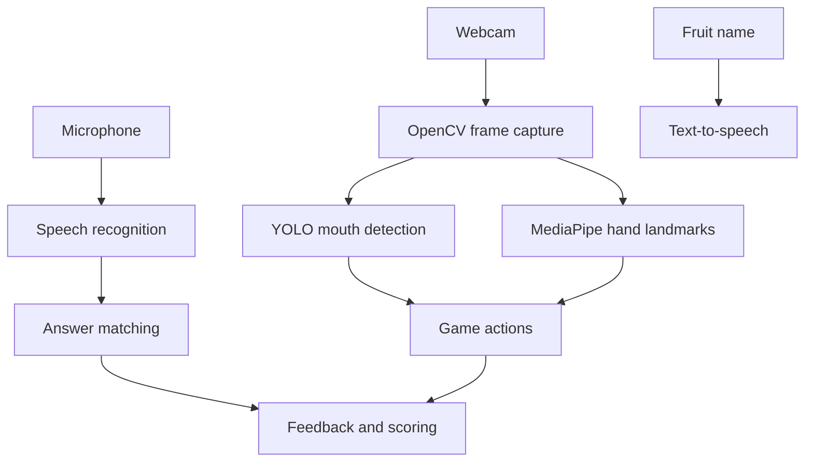

# Fruity Monster
**An AI-powered educational game that makes learning fun and interactive.**

## Project Overview

Fruity Monster is a Python-based educational game designed to help children recognize fruits, learn colors, practice English vocabulary, and distinguish edible fruits from non-food objects. It combines computer vision, speech recognition, and interactive gameplay to offer an alternative to repetitive learning activities.

## Game Modes

| Game | Description |
| --- | --- |
| Eat or Don't Eat | Control a monster using hand gestures and mouth movements. Collect fruits, avoid non-food objects and pits, and progress through five levels, including a boss level. |
| Break the Fruit | Identify the color and name of each fruit verbally. A correct color answer cracks the fruit, and a correct name answer breaks it. The game tracks correct answers, wrong attempts, skipped questions, and completion time. |
| Say the Fruit | Listen to a fruit name and repeat it using the microphone. Receive feedback and earn points for correctly recognized words. |

## Key Features

- Four selectable characters: Purple, Green, Orange, and Pink.
- Ten fruits and seven non-food objects.
- Five platformer levels with different environments, floating platforms, and a final boss.
- Real-time hand and mouth tracking using a shared webcam.
- English speech recognition and text-to-speech.
- Scores, hearts, stars, animated feedback, sound effects, and saved level progress.
- Retry and skip options in speech-based activities. Skipping does not award points or trigger fruit-breaking effects.
- Responsive game window with fullscreen support.

## Data Science and AI

| Component | Technology | Purpose |
| --- | --- | --- |
| Mouth detection | Ultralytics YOLO | Detect open and closed mouth states from webcam frames. |
| Hand tracking | MediaPipe Hand Landmarker | Extract hand landmarks and map index-finger direction to movement and jumping. |
| Image processing | OpenCV, NumPy | Capture and preprocess webcam frames for inference. |
| Speech recognition | SpeechRecognition, Google speech recognition | Convert spoken English answers into text and compare them with expected words. |
| Text-to-speech | pyttsx3 | Read fruit names aloud in Say the Fruit. |
| Game development | Arcade, Pillow | Render characters, environments, animations, and the game interface. |

### AI Workflow



The mouth detector uses the trained weights in `best.pt`. MediaPipe uses a pretrained Hand Landmarker model, followed by rule-based gesture interpretation. Spoken answers are evaluated using recognized words rather than a custom pronunciation-scoring model.

## Installation and Setup

### Requirements

- Python environment compatible with Arcade 3.3.3 and the listed packages
- Webcam and microphone
- Internet connection for Google speech recognition
- The required model files and game assets

Install the dependencies in your Python environment:

```bash
python -m pip install arcade==3.3.3 ultralytics mediapipe opencv-python numpy pillow SpeechRecognition pyttsx3 pyaudio
```

### Project Structure

Keep the game script and assets in the same project directory. The following layout assumes the final script is named `Fruity_Monster_Skip_Fixed.py`.

```text
Fruity-Monster/
├── Fruity_Monster_Skip_Fixed.py
├── README.md
├── best.pt
├── hand_landmarker.task
├── purple/
├── green/
├── orange/
├── pink/
├── apple.png, banana.png, strawberry.png, ...
├── sock.png, shoe.png, toy.png, ...
├── heart_full.png
├── heart_empty.png
├── pastel_scenery.png
├── *.wav
└── progress.json (generated when progress is saved)
```

Each character folder contains `idle.png`, `mouth_open.png`, `walk_1.png` through `walk_4.png`, `happy.png`, `sad.png`, `win.png`, and `game_over.png`. The character folders can also be grouped under a `Characters/` directory.

Required fruit images: apple, banana, strawberry, orange, grapes, watermelon, mango, kiwi, pineapple, and cherries. Required non-food images: sock, shoe, toy, pencil, toothbrush, soap, and eraser. Sound files are optional; missing sounds are skipped by the game.

### Run the Game

From the project directory:

```bash
python Fruity_Monster_Skip_Fixed.py
```

Or in JupyterLab:

```python
%run Fruity_Monster_Skip_Fixed.py
```

## How to Play

| Input | Action |
| --- | --- |
| Point your index finger right or left | Move the monster in the corresponding direction. |
| Point your index finger upward | Jump. |
| Relax the gesture or move your hand out of view | Stop movement. |
| Open your mouth near a collectible | Eat the item in Eat or Don't Eat. |
| LISTEN | Hear the fruit name in Say the Fruit. |
| Microphone / SPEAK | Start recording; press again to stop and recognize the answer. |
| SKIP | Skip an unanswered question when enabled after an incorrect or unclear response. |
| F11 | Toggle fullscreen. |
| Esc | Go back. |
| C / D (platformer) | Retry the camera / toggle tracking status. |

## Limitations

- Computer vision performance depends on lighting, camera angle, visibility, and hardware capabilities.
- Speech recognition depends on microphone quality, background noise, internet connectivity, and how accurately the service transcribes children's speech.
- The speech activities assess recognized vocabulary, not detailed pronunciation quality.
- Educational benefits are intended outcomes; learning effectiveness has not been established by a formal user study in this README.

## Future Improvements

- Evaluate mouth detection and gesture recognition across diverse lighting conditions and users.
- Conduct usability testing and measure learning outcomes.
- Expand vocabulary and add more educational challenges.
- Explore offline speech recognition and accessibility improvements.

## Project Context

Developed as a Data Science capstone project, combining AI inference, human-computer interaction, and educational game development.
